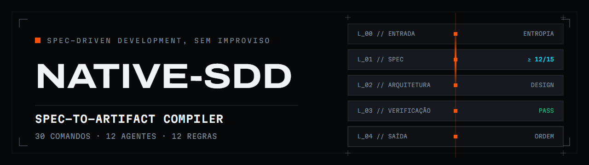

<p align="center">
  
</p>

<h1 align="center">Native-SDD</h1>

<p align="center">
  <a href="README.md">Português</a> · <strong>English</strong> ·
  <a href="https://github.com/Phenrique-DataDev/Native-sdd/releases/latest">Latest release</a> ·
  <a href="https://nativesdd.me">nativesdd.me</a>
</p>

<p align="center">
  
  
  
  <a href="https://github.com/Phenrique-DataDev/Native-sdd/actions/workflows/smoke.yml"></a>
  <a href="LICENSE"></a>
</p>

---

Native-SDD sets up your machine for Claude Code and gives every new project a Spec-Driven
Development (SDD) workflow: five phases, each one writing an artifact the next one reads, so
requirements and design are on disk before the code is. A small-task shortcut (`/dev`), a
conformance check (`/check`) and a pre-commit hook that blocks secrets come with every project.

> **Language note.** The scaffold's commands, agents and templates are written in Brazilian
> Portuguese. Your own project can be in English: the sections the linters require are recognized
> in both languages, and the commit-message language is one line in the project's `AGENTS.md`.
> The detailed docs ([usage guide](docs/USO.md), [vision](docs/VISAO.md)) are in Portuguese.

## Who it's for

| If you are building… | What the scaffold gives you |
|---|---|
| **A game** (Unity, Godot, Unreal) | `/adapt` recognizes the engine from its project marker, and the CI offer explains why Unity and Unreal are declined. `/supplements gamedev` installs the official Unity and Epic Games plugins. The spec has a **human judgment** section for what no number decides (game feel, difficulty), with who judges and what counts as a pass. `visual-check` screenshots a Godot window at a size it proves first. |
| **Something on top of an LLM** | Declaring an LLM component in the spec turns its acceptance tests into a **rate over N fixed cases**, with a baseline and a judge, instead of one lucky run. The design records which steps the code decides and which the model decides. The `security-reviewer` treats model output, retrieved documents and tool results as untrusted input (OWASP Top 10 for LLM Applications). `/supplements ai` adds Agent SDK, MCP server and plugin tooling. |
| **Data pipelines** | `/adapt` detects Python and dbt projects. `/supplements data` adds data-agent-kit, ClickHouse best practices and DuckDB skills. |
| **A web UI** | A `designer` agent with three modes (refine an existing screen, match a Figma source, start from scratch), a `visual-check` skill that screenshots the page at proven widths before anyone says "done", and a redesign track in `/dev` that shows before and after for approval before touching code. |
| **On an existing codebase** | `/adapt` detects the stack and the test, CI and docs hygiene, absorbs an existing `.claude/` without overwriting it, and hands off to `/curate`. |

**Not for you if** you only want a `CLAUDE.md` and a handful of commands, or need measured support
in a tool that has not been verified yet ([supported tools](#supported-tools)). See also the
[comparison with Spec Kit and OpenSpec](docs/VISAO.md#alternativas-spec-kit-e-openspec) (Portuguese).

## The workflow

| Phase | Command | What it produces |
|---|---|---|
| 0 · Brainstorm | `/brainstorm` | Explores the idea before fixing requirements |
| 1 · Define | `/define` | Requirements and acceptance tests, each one with the condition that fails it |
| 2 · Design | `/spec` | Architecture and technical spec |
| 3 · Build | `/build` | Implementation with real lint and tests, plus a build report |
| 4 · Ship | `/ship` | Archives the feature and records the lessons |

One phase at a time: each phase reads the previous phase's artifact. Small tasks skip the cycle
with `/dev`. In daily use, start with `/status`, a read-only panel that shows git, the open SDD
phase and the recommended next step.

## Quickstart

**1 · Install** (machine setup: CLIs, Claude Code, your personal `~/.claude`). The bootstrap
installs the latest tagged release, not `main`. You can read it first:
[`bootstrap.ps1`](onboarding/bootstrap.ps1) · [`bootstrap.sh`](onboarding/bootstrap.sh).

```powershell
# Windows, in PowerShell
irm https://raw.githubusercontent.com/Phenrique-DataDev/Native-sdd/main/onboarding/bootstrap.ps1 | iex
```

```bash
# Linux and macOS (needs bash, curl and tar)
curl -fsSL https://raw.githubusercontent.com/Phenrique-DataDev/Native-sdd/main/onboarding/bootstrap.sh | bash
```

**See what changes before installing.** `-Check` / `--check` only reports, `-DryRun` / `--dry-run`
lists each action without running it, and `-ProjectOnly` / `--project-only` leaves your `~/.claude`
configuration alone. A normal install backs up every file it overwrites (`<file>.bak-<date>`).

```powershell
iex "& { $(irm https://raw.githubusercontent.com/Phenrique-DataDev/Native-sdd/main/onboarding/bootstrap.ps1) } -DryRun"
```

**2 · Create a project** (reopen the terminal first: the installer adds `New-SddProject`, alias
`nsp`, to your shell profile).

```powershell
nsp my-project -Open
```

The default `mvp` profile brings the five phases, `/dev`, curation and the secret-blocking
pre-commit. `-Profile full` adds orchestration (`/orchestrate`, `/max`, `/peers`) for long
multi-agent sessions.

**3 · Inside the project, in Claude Code**

```text
/setup     fills in the project context (stack, domain, conventions)
/curate    specializes the scaffold: curates agents, trains the domain knowledge base, syncs indexes
/brainstorm → /define → /spec → /build → /ship
```

**Updating** has two layers: rerun the bootstrap for the machine, then `nsp <path> -Update` in each
project (`-DryRun` shows the plan first). Files you customized are never overwritten: when the
template changed them too, they are listed as conflicts.

## Supported tools

Support is per tool (the CLI that runs the model). All of them read the same contract, the
project's `AGENTS.md`.

| Tool | Level |
|---|---|
| **Claude Code** | Native: commands, skills, hooks, subagents. Tested in CI on every release. |
| **Codex CLI**, **Hermes Agent**, **GitHub Copilot CLI**, **Antigravity CLI** | Measured live, with the destructive-command guard in Codex, Copilot and Antigravity (Antigravity does not prompt when permissions are skipped). |
| **Cursor**, **OpenCode** | Guard hook only, tested with fixtures, no live run. |

Details and how each was measured: [Ferramentas suportadas](README.md#ferramentas-suportadas--supported-tools).

## Requirements

Windows, Linux or macOS. The framework runs on PowerShell 7+, which the installer sets up. macOS is
validated on Apple Silicon CI runners, not on a physical Mac. The installer also sets up `git`,
`gh`, `node`, `python`, `uv`, `jq`, `yq` and `ripgrep`.

## License and author

[MIT](LICENSE). Built by **Pedro Henrique Lopes** (data and automation engineering):
[LinkedIn](https://www.linkedin.com/in/pedro-henrique-lopes-datadev/) ·
[GitHub](https://github.com/Phenrique-DataDev).
