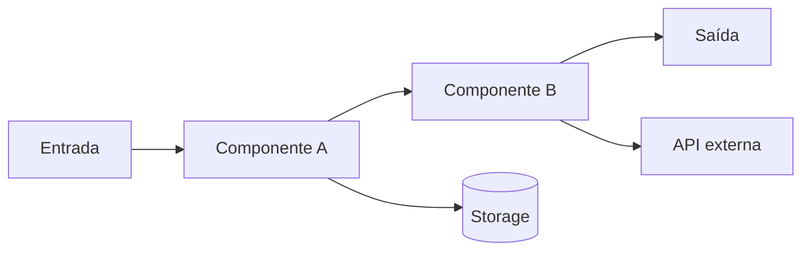

# DESIGN: {Nome da Feature}

> Design técnico para implementar {Nome da Feature}.

## Metadados

| Atributo | Valor |
|----------|-------|
| **Feature** | <FEATURE> |
| **Data** | {AAAA-MM-DD} |
| **DEFINE** | [DEFINE_<FEATURE>.md](./DEFINE_<FEATURE>.md) |
| **Status** | Rascunho / Pronto para Build |

---

## Visão de arquitetura

> Use **Mermaid** (renderiza no GitHub) **e/ou** o **diagrama ASCII** — os dois juntos ou só o
> Mermaid. Mermaid é preferível quando um HTML (visual-explainer) seria **demais** para um
> diagrama inline; o ASCII serve à leitura no terminal. Deixe só o que clarifica; apague o resto.



```text
┌────────────────────────────────────────────────┐
│  {diagrama ASCII: componentes e fluxo de dados} │
│  [Entrada] → [Componente A] → [Componente B] → [Saída]
│                   ↓                ↓            │
│              [Storage]       [API externa]      │
└────────────────────────────────────────────────┘
```

## Componentes

| Componente | Responsabilidade | Tecnologia |
|------------|------------------|------------|
| {A} | {o que faz} | {stack} |
| {B} | {…} | {…} |

## Data Flow
{passo a passo de como os dados percorrem o sistema}

## Integration Points
{APIs, serviços, bancos, filas — contratos de entrada/saída}

## Componente LLM

> Só se o DEFINE diz `Componente LLM` = sim; senão escreva `N/A — sem componente LLM no DEFINE` e
> apague as tabelas. Antes de preencher, leia `.claude/postures/llm-systems.md`. Custo e latência
> são Success Criteria do DEFINE: aqui só se referenciam.

**Padrão escolhido:** {chamada única · chain · routing · parallel · evaluator-optimizer · agente ·
multiagente} — **degrau mais simples rejeitado:** {qual, e o número do Eval Set que o reprovou}

**(a) Fronteira código × modelo**

| Passo | Quem decide | Contrato de saída | Portão |
|-------|-------------|-------------------|--------|
| {ex.: classificar o ticket} | modelo | {JSON `{categoria, confiança}`} | {validador de schema → retry 1× com o erro → fallback `triagem-manual`} |
| {ex.: gravar a categoria} | código | {linha na tabela} | {—} |

**(b) Tools expostas ao modelo** (apague se não houver)

| Tool | Schema de entrada | Efeito colateral | Portão | Saída inválida |
|------|-------------------|------------------|--------|----------------|
| {nome} | {campos e tipos, neutro de provedor} | {nenhum · reversível · irreversível} | {auto · confirma · humano} | {o que o código faz} |

**(c) Limites**

| Limite | Valor |
|--------|-------|
| Passos máximos / timeout | {…} |
| Detecção de "parado" | {ex.: mesma tool com os mesmos args 2× seguidas} |
| Backoff no erro do provedor | {…} |
| Modelo pinado · prompt versionado | {id exato do modelo · caminho do prompt no repositório} |

Retrieval, memória e estado: ver a postura; registre aqui só a decisão (ex.: "pedaços de N tokens,
recall medido no Eval Set").

## Testing Strategy
{quais testes provam cada Acceptance Test do DEFINE: unit, integração, e2e}

## Error Handling
{falhas esperadas, retries, fallback, mensagens}

## Security
{validação de input, segredos, autenticação/autorização, dados sensíveis}
{com componente LLM: saída do modelo, documento recuperado e resultado de tool são input não
confiável — diga onde cada um é validado antes do sink}

## Observability
{logs, métricas, traços — o que medir e como verificar em produção}
{com componente LLM: trace das tool calls e decisões do modelo, tokens e latência por chamada}

## Conhecimento da KB consultado

> Entradas da KB curada que **ancoraram** este design (passo *Aterrar na KB* do `/spec`). Liste o `id`
> real de cada entrada usada — é o rastro de que o plano se apoia no conhecimento do projeto, não em
> improviso. Se a KB ainda **não** foi treinada (`/train-kb`), deixe a nota de degradação.

| Entrada (`id`) | Camada | Por que ancora este design |
|----------------|--------|----------------------------|
| {ex.: `orders-schema`} | implementation | {ex.: contrato/IDs reais que o componente A consome} |
| {ex.: `deploy-runbook`} | operations | {ex.: passos de recuperação que o Error Handling reusa} |

> _KB não treinada (rode `/train-kb`) — design não ancorado em conhecimento curado._ ← use **esta linha**
> no lugar da tabela quando a pré-condição não vale.

## Localização e infra
- **Onde o código mora:** {caminho}
- **Mudanças de infra/IaC:** {recursos novos/alterados ou N/A}

---

**Próximo passo:** `/build .claude/sdd/features/DESIGN_<FEATURE>.md`
